# AI infrastructure on HPC and NVIDIA GPUs

[](https://github.com/santoshmyakala/ai-infrastructure-hpc-gpu/actions/workflows/ci.yml)


Reference implementation of a **GPU training platform** in its two common forms:
- **Kubernetes:** NVIDIA GPU Operator, MIG and time-slicing, Kueue quotas, Kubeflow PyTorchJob, DCGM alerting.
- **Classic HPC with Slurm:** GRES GPU scheduling, InfiniBand topology awareness, Pyxis/Enroot containers.

Both run on **AWS** (EKS with p5 instances, EFA and FSx for Lustre) and **Azure** (AKS with ND H100 v5 and Managed Lustre), as tested Terraform. A licensing guide covers every NVIDIA and HPC component: **[docs/licensing.md](docs/licensing.md)**.

## Architecture

<picture>
  <source media="(prefers-color-scheme: dark)" srcset="docs/diagrams/platform-dark.svg">
  
</picture>

<sub>Animated diagram generated from <a href="docs/diagrams">docs/diagrams/*.yaml</a> with <a href="https://github.com/santoshmyakala/santoshmyakala/tree/main/tools/archdiagram">archdiagram</a>.</sub>

## What's in the repo

| Path | Contents | Proven by |
|---|---|---|
| `training/train_ddp.py` | PyTorch DDP reference job: identical code on laptop, Slurm and Kubernetes; reports throughput and verifies replicas stay in sync | **Runs in CI:** 2 processes on CPU (gloo) train, loss decreases, weights identical across ranks |
| `kubernetes/gpu-operator/` | GPU Operator values, time-slicing (4× sharing), MIG layouts for H100 | YAML + kubeconform |
| `kubernetes/kueue/` | ResourceFlavor (H100), research and production queues in a cohort with borrowing and lending limits | kubeconform against Kueue CRDs |
| `kubernetes/jobs/` | 2-node × 8-GPU PyTorchJob; NCCL all-reduce bandwidth job | PyTorchJob validated against the Kubeflow v1.9.4 CRD |
| `kubernetes/monitoring/` | DCGM alerts: XID errors, temperature, row remap, GPUs allocated but idle (cost) | kubeconform against Prometheus Operator CRD |
| `slurm/etc/` | `slurm.conf` (cons_tres, GRES, fair-share, backfill, topology), `gres.conf` (NVML autodetect), `cgroup.conf`, `topology.conf` | **A real `slurmctld` 23.11 loads it** in CI |
| `slurm/jobs/` | Multi-node DDP via `srun torchrun` in NGC containers; cross-node NCCL test | shellcheck |
| `ansible/` | GPU node role: open kernel modules, container toolkit + CDI, DCGM, persistence daemon, slurmd, NVML health check | ansible-lint **production** profile |
| `terraform/aws/` | EKS GPU node group: p5.48xlarge, **32 EFA interfaces**, cluster placement group, capacity reservation support, FSx for Lustre PERSISTENT_2 | `terraform test` (3 runs) |
| `terraform/azure/` | AKS ND H100 v5 pool, proximity placement group, Managed Lustre, same zone | `terraform test` |

## Sharing GPUs: which mechanism when

| Mechanism | Isolation | Use for | Licence |
|---|---|---|---|
| Whole GPU | Full | Training, large inference | Free |
| **MIG** (A100/H100/H200/B200) | Hardware: memory, cache, SMs, fault | Many small isolated inference or notebook workloads | Free (no vGPU licence on bare metal/Kubernetes) |
| **Time-slicing** | None (shared memory, no fault isolation) | Dev/test density, bursty light inference | Free |
| MPS | Partial (compute partitioning) | Many small CUDA processes from one user | Free |
| vGPU (hypervisor) | VM-level | VDI, multi-tenant VMs | **Paid** NVIDIA vGPU licence |

## Operating the platform

1. **Bring-up checks for a new node:**
   - `nvidia-smi` and `dcgmi diag -r 3`;
   - NCCL all-reduce on a single node: bus bandwidth should approach the NVLink spec;
   - NCCL across nodes: should approach the EFA or InfiniBand line rate.
2. **Scaling efficiency:** run `train_ddp.py` at 1, 8 and 16 GPUs and compare `samples_per_sec` per GPU. Investigate NCCL, the network or the input pipeline when efficiency drops below ~90%.
3. **Health:** an XID alert means cordon and drain, then `dcgmi diag`. Pending row remaps need a GPU reset at the next maintenance window.
4. **Cost:**
   - GPU nodes scale to zero;
   - Kueue lets research borrow idle production GPUs, with a lending cap that protects production;
   - the "allocated but idle" alert finds forgotten notebooks.

## Run locally

```bash
pip install torch pytest && pytest -q tests
```

```bash
torchrun --nproc-per-node 2 training/train_ddp.py --backend gloo
```

```bash
sudo apt-get install slurm-wlm && sudo scripts/check_slurm_conf.sh
```

Actual local output (2 CPU processes):

```json
{"world_size": 2, "backend": "gloo", "device": "cpu",
 "history": [{"epoch": 0, "loss": 2.252}, {"epoch": 1, "loss": 2.085}, {"epoch": 2, "loss": 1.808}],
 "weights_in_sync": true}
```

> GPU-specific throughput numbers aren't published here because no GPU hardware was available for these runs. The scripts are ready to produce them on real nodes.

## Licence

MIT. Third-party licensing is covered in [docs/licensing.md](docs/licensing.md).
